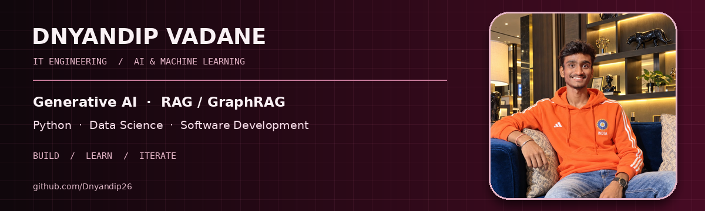
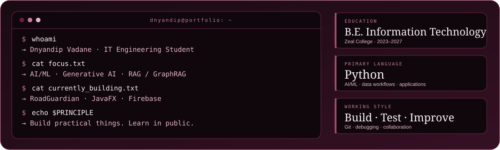
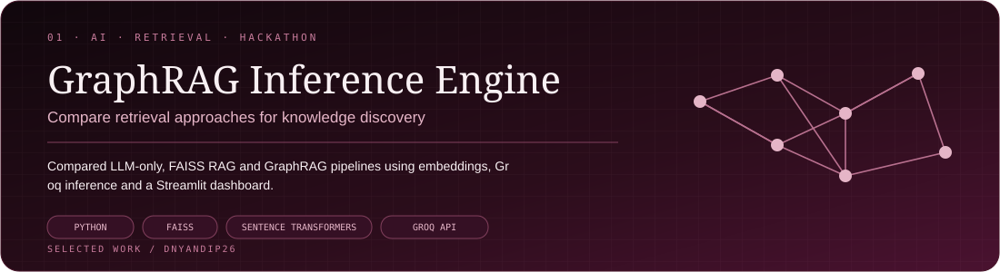
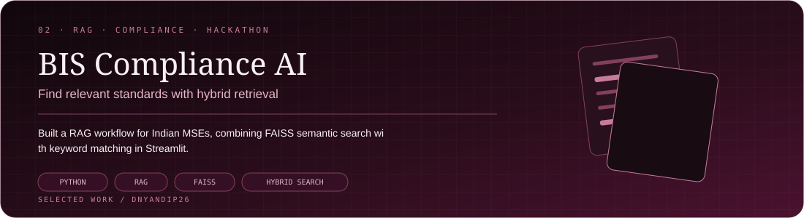
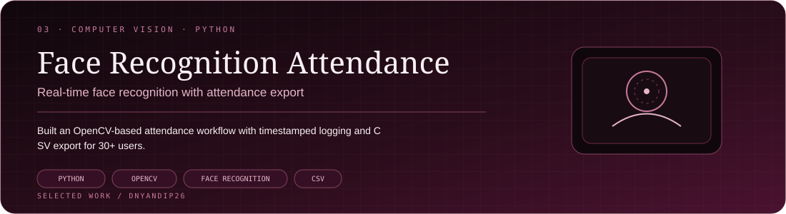

### IT Engineering Student · AI/ML · Generative AI · Software Development

I build practical AI applications, retrieval systems, and software projects — learning by turning ideas into working prototypes.

---

## 01 / About me

I'm **Dnyandip Vadane**, a final-year **B.E. Information Technology** student at **Zeal College of Engineering & Research, Pune** (2023–2027). My work and learning span AI/ML, computer vision, retrieval-augmented generation, data analysis, and software development.

- Building Python-based AI applications and exploring LLM-powered retrieval workflows.
- Interested in RAG, GraphRAG, data processing, and practical ML problem-solving.
- Working as a **Java Development Intern at Incubators by Core2Web**, contributing to RoadGuardian.
- Strengthening software engineering practices through testing, debugging, Git, and collaborative development.

## 02 / Selected work

**GraphRAG Inference Engine — TigerGraph Hackathon**  
Compared LLM-only, standard RAG using FAISS, and GraphRAG pipelines for knowledge retrieval. Used Sentence Transformers for embeddings and Groq API for LLM inference, with a Streamlit comparison dashboard.

**Stack:** Python · FAISS · Sentence Transformers · Groq API · Streamlit

**BIS Compliance AI — Hackathon Project**  
Built a retrieval-augmented generation pipeline to help Indian micro and small enterprises find relevant Bureau of Indian Standards regulations. Combined FAISS semantic retrieval with keyword matching in a Streamlit interface.

**Stack:** Python · RAG · FAISS · Hybrid Retrieval · Streamlit

**AI-Based Face Recognition System**  
Built a real-time face-recognition attendance system using Python and OpenCV, with timestamped attendance logging and CSV export for 30+ users.

**Stack:** Python · OpenCV · face_recognition · CSV  
**Repository:** [Face Detection using Python](https://github.com/Dnyandip26/Face-Detection-using-Python)

**More projects I'm building or exploring**
- **RoadGuardian** — smart road-safety application using Core Java, JavaFX, and Firebase as part of my internship.
- **Phishing Email Detection Dashboard** — a Python ML dashboard exploring feature engineering and classification.
- **Poll Results Visualizer** — an interactive Python dashboard for poll-data analysis and CSV uploads.
- **SafeSense AI** — a food-safety intelligence project concept focused on product analysis and regulatory information.

> Additional projects are listed as work in progress or project explorations; this README does not imply that each is deployed or production-ready.

## 03 / Technology constellation

## 04 / Experience

### Java Development Intern — Incubators by Core2Web
*July 2026 – Present*

- Working on **RoadGuardian**, a smart road-safety application using Core Java and JavaFX.
- Implemented geo-tagging and image-validation logic with attention to data integrity.
- Integrated Firebase for real-time synchronization.
- Participated in application testing, Git-based version control, and team collaboration.

### IR 4.0 Technologies Training — Edunet Foundation / TechSaksham
*February 2025 – March 2025*

- Trained in Python, data analysis, Linux, AI, and Industry 4.0 technologies under the Microsoft–SAP initiative.
- Used Pandas and NumPy for structured dataset handling and data analysis.

## 05 / Education

| Qualification | Institution | Period / Result |
|---|---|---|
| B.E. Information Technology | Zeal College of Engineering & Research, Pune | 2023–2027 · CGPA 8.60* |
| HSC | Residential Junior College of Science, Shevgaon | 2021–2023 · 75.50% |
| SSC | Bhatkudgaon High School | 2020–2021 · 87.60% |

*Confirm that 8.60 is your official current CGPA before publishing.

## 06 / Certifications & training

- Microsoft–SAP IR 4.0 Technologies Training
- NVIDIA — Generative AI
- IBM — Generative AI
- Azure AI Essentials
- LinkedIn Learning — Data Analytics

## 07 / GitHub activity

 

## 08 / Let's connect

If you're working on AI applications, retrieval systems, data-driven tools, or practical software projects, I'd be happy to connect and learn.

<a href="https://github.com/Dnyandip26">GITHUB</a> · <a href="https://www.linkedin.com/in/dnyandip-vadane/">LINKEDIN</a> · <a href="mailto:dnyandipvadane@gmail.com">EMAIL</a>

