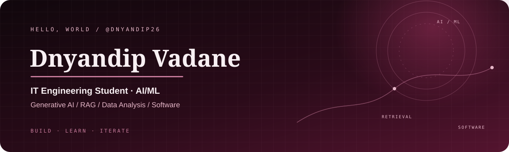

---

01 / ABOUT ME

# Hello, I'm <em>Dnyandip.</em>

**IT Engineering Student · AI/ML · Generative AI · Software Development**

I build practical AI applications, retrieval systems, and software projects — turning ideas into working prototypes through experimentation, problem-solving, and continuous learning.

## `whoami` — A little about me

<table>
<tr>
<td width="62%" valign="top">

- 🎓 Final-year **B.E. Information Technology** student at Zeal College of Engineering & Research, Pune.
- 🤖 Interested in **AI/ML, Generative AI, RAG, GraphRAG, and data analysis**.
- 🧩 Enjoy building applications that combine retrieval, data processing, and useful interfaces.
- 💻 Currently working as a **Java Development Intern**, contributing to a road-safety application.
- 🌱 Focused on strengthening software engineering, AI application development, and project-building skills.

</td>
<td width="38%" valign="top">

### Quick profile

| | |
|---|---|
| **Education** | B.E. IT |
| **Graduation** | 2027 |
| **Location** | Pune, India |
| **Primary language** | Python |
| **Also use** | Java, SQL |
| **Current focus** | AI applications + software |

</td>
</tr>
</table>

## `stack --list` — Technologies

**Programming**

**AI / ML and Generative AI**

**Data, UI and Tools**

## `projects --featured` — Selected work

<table>
<tr>
<td width="50%" valign="top">

### GraphRAG Inference Engine
**TigerGraph Hackathon · 2025–2026**

Compared LLM-only, standard RAG with FAISS, and GraphRAG pipelines for knowledge retrieval. Used Sentence Transformers for embeddings and Groq API for inference, with a Streamlit comparison dashboard.

**Built with:** Python · FAISS · GraphRAG · Sentence Transformers · Groq · Streamlit

</td>
<td width="50%" valign="top">

### BIS Compliance AI
**Hackathon project · 2026**

Built a retrieval-augmented pipeline to help Indian MSEs identify relevant BIS regulations. Combined FAISS semantic retrieval with keyword matching in a Streamlit interface.

**Built with:** Python · RAG · FAISS · Hybrid Retrieval · Streamlit

</td>
</tr>
<tr>
<td width="50%" valign="top">

### Face Recognition Attendance
**Computer Vision · 2025**

Built a real-time face-recognition attendance system using Python and OpenCV, with timestamped attendance logging and CSV export for 30+ users.

**Built with:** Python · OpenCV · Face Recognition · CSV

</td>
<td width="50%" valign="top">

### RoadGuardian
**Java Development Internship · 2026–Present**

Contributing to a smart road-safety application. Work includes geo-tagging, image-validation logic, Firebase real-time synchronization, application testing, and Git-based collaboration.

**Built with:** Core Java · JavaFX · Firebase · Git

</td>
</tr>
</table>

> **Repository links:** Add the real public repository URLs to each project when confirmed. The links are intentionally not guessed.

## `experience --timeline`

### Java Development Intern · Incubators Systems
July 2026 – Present

- Developing **RoadGuardian**, a smart road-safety application using Core Java and JavaFX.
- Implemented geo-tagging and image-validation logic; integrated Firebase for real-time synchronization.
- Performed application testing and used Git for version control and team collaboration.

### IR 4.0 Technologies Training · Edunet Foundation / TechSaksham
February 2025 – March 2025

- Trained in Python, data analysis, Linux, AI, and Industry 4.0 technologies.
- Used Pandas and NumPy for structured dataset handling and analysis.

## `education --details`

| Qualification | Institution | Result / Period |
|---|---|---|
| B.E. Information Technology | Zeal College of Engineering & Research, Pune | CGPA 8.60 · 2023–2027 |
| HSC | Residential Junior College of Science, Shevgaon | 75.50% · 2021–2023 |
| SSC | Bhatkudgaon High School | 87.60% · 2020–2021 |

## `certifications --verified-from-resume`

- Microsoft–SAP IR 4.0 Training
- NVIDIA Generative AI
- IBM Generative AI
- Azure AI Essentials
- LinkedIn Learning — Data Analytics

## `github --activity`

Third-party stats widgets can be unavailable or rate-limited; displayed values come from those services.

---

**Thanks for visiting my profile.**  
*Learn continuously · Build thoughtfully · Improve every day*

